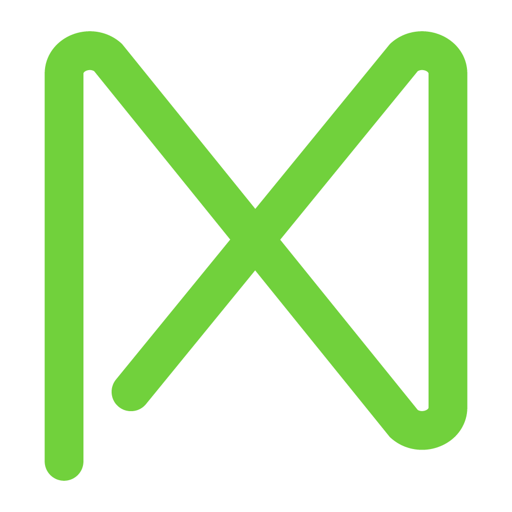

# MoodBox - Design Reference Boards, Clipboard History & Quick Launcher

> A Windows productivity workspace (desktop app v2.4.0) plus a Chrome extension (Manifest V3, v9.3.0) that work together: capture images and fonts from the web into reference-board projects, keep clipboard history, launch apps fast, and more.

## Two parts, one product

| Part | What it is |
| --- | --- |
| Desktop app | MoodBoard projects, clipboard history, quick launcher, power scheduler, Explorer context menus, font converter, force delete, junk cleaner |
| Chrome extension | One-click image/font download, project capture, note picker, library |

Install the **desktop app first**, then load the extension from the installed app's `Extension` folder. The extension only works while the desktop app is running.

## Features

> **⭐ The essentials - learn these first, and MoodBox will save you hours every week.**

### Quick Launcher - open anything in a second
- Press **`Ctrl + Space`** anywhere to open the Quick Launcher, then type and launch an app or file instantly.
- **Right-click any `.py`, `.exe`, `.bat` or `.cmd` file** in Windows Explorer and add it to the Quick Launcher - your favourite tools are always one shortcut away.

### Smart Clipboard - never lose a copy again
- Press **`Win + Space`** to open the Smart Clipboard: your full copy history (text and images), ready to paste with one click.

### MoodBox projects - collect references, generate a board
- **Create a project:** keep the desktop app running, **right-click in Explorer → Create MoodBox**, and a new project is ready.
- **One-click reference:** once a project exists, a **MoodBox icon appears over images** - click it and that image is added to your project as a reference, instantly.
- **Save with a note:** right-click any image → **MoodBox → Send to MoodBox** to save it as a reference **with your note** attached.
- **Smart notes with `@`:** in the Note Picker, **press `@` and start typing** - matching words from your design library appear automatically, so taking notes and writing observations is fast and effortless.
- **Generate your board:** select a MoodBox project, **right-click → Generate MoodBox**, and it exports everything at once - a **PNG board, an HTML board, and a Photoshop script**.

### Desktop app
- **MoodBoard projects** - Create a project folder with a `_Library` of captured images and a `moodbox.json` manifest, then export it as an HTML board, PDF, PNG/JPG, or an export script, with color-intelligence analysis (dominant colors and more). Default categories: Design, Reference, Inspiration, Typography, Color.
- **Clipboard history** - Keeps text and image clipboard items (default up to 10,000 records / 7 days), paste-on-click, hotkey `Win+Space`.
- **Quick Launcher** - Launch apps and files from a shortcut list, hotkey `Ctrl+Space`.
- **Power Scheduler** - Schedule Windows power actions (shutdown, sleep, and more) on a timer.
- **Explorer context menus** - Right-click entries: Create MoodBox, Generate MoodBox, Quick Launcher, Force Delete, Font Converter.
- **Font converter** - WOFF2 → TTF conversion.
- **AI package export** - Build an "AI task" package from a project (preview image + `project_data.json` with your notes, keywords, and design observations + a built-in instruction prompt) to paste into your own AI chat for a design breakdown. The AI itself is not in the app.
- **Design vocabulary** - A curated bilingual (English + Bengali) vocabulary of design observations used by the extension's Note Picker.

### Chrome extension
- **Grab a whole page:** on any web page, **click the MoodBox extension icon** to grab **all images and fonts on that page** - then download everything, or just the items you select.
- **One-click image download** - Hover download button, context-menu "Download Image", and a batch download page. **Hover any image and right-click** to download that image.
- **Download any font as TTF** - **Select any text on a page, then right-click**, and its font downloads as a **TTF** file.
- **WOFF2-to-TTF font download** - Detects webfonts on the page and converts them in the browser, or via the desktop bridge.
- **Project capture** - Send an image, note, and source URL to the active desktop project.
- **Note Picker** - Attach a design-vocabulary note to a capture. Press `@` and type to get instant suggestions from your library.
- **Library** - View your captures; popup shows whether the desktop bridge is connected.

## Download & Install

1. Go to the [Releases](../../releases) page.
2. Download `MoodBox Setup.exe` and run it. It installs the desktop app and the extension files, and registers the Explorer context menus.
3. In Chrome, open `chrome://extensions`, turn on **Developer mode**, click **Load unpacked**, and select the `Extension` folder inside the installed app (under `%LOCALAPPDATA%\Programs\MoodBox`).

You can also download the extension on its own from the Releases page (`MoodBox-Extension.zip`) and load it unpacked in Chrome. It needs the desktop app running to capture projects.

## How the extension talks to the desktop app

The two halves sync over a **local-only loopback HTTP server** - no cloud, no account, no API key:

- The desktop app listens on `http://127.0.0.1:57684` only (loopback, so no other machine on the network can reach it).
- The extension calls it at that address, with endpoints like `GET /health`, `GET /api/projects`, `GET /api/capture-mode`, `GET /api/vocabulary`, `POST /api/convert-woff2`, and `POST /api/add-image`.

> **Security note:** The bridge has **no authentication** - any program already running on your own machine could call it. That is a deliberate trade-off for a local-only tool, but do not treat the bridge as authenticated, and do not expose the port beyond loopback.

## How to Use

1. Start the desktop app and create a MoodBox project (right-click in Explorer → **Create MoodBox**), or pick an existing one.
2. In Chrome, click the MoodBox icon - the popup shows the bridge status. Click the extension on any page to grab all its images and fonts at once.
3. Hover any image on a web page and click the MoodBox icon on it to add it as a reference, or right-click → **MoodBox → Send to MoodBox** to save it with a note. Press `@` in the Note Picker for instant library suggestions.
4. Need a font? Select text on a page, right-click, and download it as TTF. Need an image? Hover it, right-click, download.
5. Press `Ctrl + Space` for the Quick Launcher, `Win + Space` for the Smart Clipboard.
6. Back in the desktop app, select your project, right-click → **Generate MoodBox** - your PNG board, HTML board, and Photoshop script are generated together.

## Contributing

Found a bug or have an idea? See [CONTRIBUTING.md](CONTRIBUTING.md). The browser extension files are in `extension/` - fixes and improvements to the extension are welcome as pull requests.

## License

Distributed under the **PolyForm Noncommercial License 1.0.0** - free for personal, non-commercial use. You may use it and share it, but you may **not** sell it or claim it as your own. See [LICENSE](LICENSE).

## Author

**Moshiur Rahman ([@moshclusive](https://github.com/moshclusive))** - Graphic Designer, Fiverr Level 2 Seller, tool builder.

- LinkedIn: https://www.linkedin.com/in/moshclusive/
- Facebook: https://www.facebook.com/moshclusive
